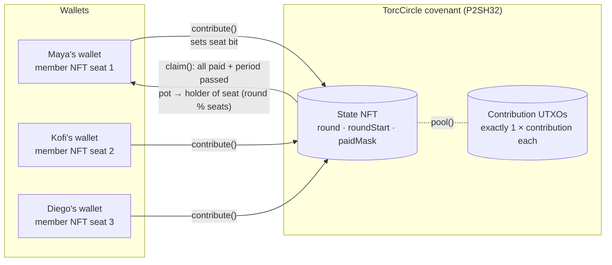

# Torc

> In a savings circle, one person holds everyone's money. In Torc, nobody does. The ring pays whoever's turn it is, and only them.

Torc is a **rotating savings circle on Bitcoin Cash**. Three to five members each put a fixed
dollar amount (PUSD) into the circle every round, and a CashScript covenant pays the whole pot only to the
member whose turn it is. Membership is a CashTokens NFT, the circle's state is a CashTokens NFT, and no
collector ever holds the money. There is no admin key.

**Try it in 10 seconds:** https://torc-cash.vercel.app (BCH mainnet). No wallet, no setup: the home page reads a live
circle from the chain, and "Run the next step live" broadcasts a real transaction you watch land as SEEN 0-conf.

<!-- 15-second GIF / screenshot slot: docs/media/torc-15s.gif (record per docs/DEMO-SCRIPT.md) -->

Built during BCH BLAZE 2026 (all commits 18–22 Nov 2026). Mainnet Track + General Protocols "Build with XO".

---

## Why Torc

A torc is the Iron Age neck ring: a closed circle of twisted gold that held the wearer's wealth. Torc is the
members' pooled pot, locked in one unbreakable ring, passing hand to hand as each turn comes round.

Rotating savings circles are a global habit: tandas in Mexico, hui in China, chit funds in India, susu in Ghana, ajo and esusu in Nigeria, where Torc started. They work
on trust in one person, the collector. Torc keeps the social contract (fixed members, fixed amount, a fixed
turn order) and removes the one point of failure: the money sits in a covenant that can only ever pay the
seat whose turn it is.

What Torc does not claim: it is not the first rotating savings circle on a blockchain (others exist on other
chains). The claim is narrower: **BCH does this natively, in dollars, for about a quarter of a cent per
contribution, with no admin key and no custodian.**

## How it works



- **One category per circle.** Genesis spends an outpoint at index 0; its txid becomes the circle's CashTokens
  category, known before the covenant address is computed. Genesis mints exactly one **state NFT** (mutable,
  into the covenant) and one **member NFT** per seat (immutable, to each member). No minting NFT ever exists,
  so the supply is fixed forever.
- **State NFT** commitment (6 bytes, LE): `round (1) | roundStart (4, unix seconds) | paidMask (1)`.
  The turn seat is `round % seats`.
- **Member NFT** commitment: `seat (1) | version (1)`. Whoever holds seat *i*'s NFT **is** seat *i*. Seats
  can change hands with an ordinary token transfer (demonstrated on chipnet, see Deployments).
- **Self-describing:** the genesis also carries the circle's parameters in an OP_RETURN, so `/circle/<address>`
  rebuilds any Torc circle from the chain alone and checks it hashes to the address.

### Contract functions (`contracts/TorcCircle.cash`, CashScript 0.14)

| Function | Spends | Enforces |
|---|---|---|
| `contribute()` | input 0 = state NFT, input 1 = a member NFT | seat's bit not yet set; output 0 = state with `paidMask \| 2^seat`, same round and roundStart, same sats, still mutable at the covenant; output 1 = exactly `contribution` of the asset (no NFT) locked to the covenant; output 2 = the member NFT back to its holder, unchanged |
| `claim()` | input 0 = state, input 1 = the turn seat's NFT, inputs 2..seats+1 = contributions | seat == round % seats; every bit set; `tx.time >= roundStart + period`; output 0 = state with round+1, paidMask 0, roundStart = tx.locktime; output 1 = exactly `contribution × seats` to **input 1's own locking bytecode** (the seat holder, the only possible recipient); output 2 = member NFT back; each pooled input is a real contribution from the covenant |
| `pool()` | a contribution UTXO | only as input 2..seats+1 of a tx whose input 0 is this circle's state NFT and whose output 0 advances the round, i.e. inside a valid `claim()`. Pooled money can never move in a contribute tx or any other tx |

BCH mode (`contracts/TorcCircleBch.cash`) is the same covenant with the contribution in satoshis. Two small
contracts instead of a runtime flag keep every redeem script (and so every round's fee) smaller.

## Security model

**What the covenant enforces:** only a member-NFT holder can touch the state; each seat pays at most once per
round; the pot can only be claimed when every seat has paid and the period has passed; the whole pot goes to
the turn seat's holder and nobody else; pooled contributions can only leave through a claim; the state NFT can
never leave the covenant or be duplicated (consensus: one mutable input yields one NFT out).

**What it does not enforce:** that members keep paying. A member can stop contributing; then nobody can claim
(see below). It does not know who a person is: whoever holds a seat NFT is that seat. It does not set a deadline
for contributions.

**Why there is no admin key:** there is nothing to administer. Every rule is in the covenant and every parameter
is fixed at creation (changing any of them gives a different address). Torc's server holds no member funds;
its only keys are the throwaway demo-seat keys of its own demo circle, derived inside the Vercel function from a
secret seed.

**What happens if someone doesn't pay:** nobody can claim until every bit is set, so the circle stalls
visibly and the pot stays locked and safe. Real circles resolve it socially (the defaulter pays, or the group
agrees on a replacement who buys the seat NFT). v2 idea: bond NFTs, where each member locks a deposit that is
forfeited to the pot if they miss a round.

The full threat model (dust griefing, stuck rounds, burned member NFTs, malleability, fee sniping, MTP vs wall
clock) is in [SELF-AUDIT.md](SELF-AUDIT.md).

## Cost per round

Measured from the tests (`docs/metrics.json`), 1 sat/byte, BCH = $208.25 (CoinGecko and Kraken, 18 Nov 2026 18:58 UTC):

| Circle | Redeem script | Contribute tx | Claim tx | Fees per full round | ≈ USD per round | ≈ USD per contribution |
|---|---|---|---|---|---|---|
| PUSD, 3 seats | 486 B | 1,312 B | 2,687 B | 6,623 sats | $0.014 | $0.0027 |
| PUSD, 5 seats | 486 B | 1,312 B | 3,753 B | 10,313 sats | $0.021 | $0.0027 |
| BCH, 3 seats | 439 B | 1,012 B | 2,460 B | 5,496 sats | $0.011 | $0.0021 |
| BCH, 5 seats | 439 B | 1,012 B | 3,432 B | 8,492 sats | $0.018 | $0.0021 |

In PUSD mode each contribution UTXO carries exactly 1,000 sats (enforced), which pays most of the claim fee.

## Deployments

See [docs/DEPLOYMENTS.md](docs/DEPLOYMENTS.md) (generated from `deployments/*.json`, every txid linked).

- **Chipnet web demo:** shown on the site as "Torc Demo Circle" (seats Maya, Kofi, Diego; the on-chain record calls it "Lagos Market Circle"), `bchtest:rwn42zlapczu660my03ws0m7kfl6pl4350q4dvgvat0459n95wj6zmgf2vfmg`
  (seats held by the server's demo keys, driven by the site's button; **10-minute test rounds**, real circles
  use a day or a week). The site reads it through its own `/api/chain` / `/api/circle` relay (the server talks
  Electrum), so browsers never need a WebSocket.
- **Chipnet CLI run:** recorded as "Lagos Market Circle (CLI run)", 2 full rounds plus a seat transfer (seat 3 moved to a new holder).
- **Chipnet XO run:** "XO Circle", contributions made through the XO engine (see docs/XO.md).
- **tPUSD** (chipnet test asset, 2 decimals like PUSD): `fb9175ea28b49f530d1e21d521f52c91cf52db90c07af4c5bffbb85fcbb725d4`.
- **Mainnet (live on https://torc-cash.vercel.app):** "Torc Demo Circle" (`deployments/mainnet.json`), 3 seats
  (Maya, Kofi, Diego), 2,000 sats each, 600 s test rounds, genesis
  [`30aa2014…`](https://explorer.bitcoinunlimited.info/tx/30aa20143d3ff62f68277725f8c947a9dd530b6f280b7deebae661ff78969077).
  The network switches by env alone (`NEXT_PUBLIC_NETWORK=mainnet`, `NETWORK=mainnet` for scripts).

## How a judge makes a useful mainnet transaction

On a mainnet deployment, open `/new` on your phone:

1. **Connect wallet** and scan with Selene (WizardConnect).
2. **Use my address for every seat**, pick PUSD (or BCH), keep the amount small, **Create circle**, approve.
   That genesis mints your circle's state NFT into a covenant and three member NFTs to you.
3. On the circle page tap **Contribute** under a seat and approve. That is a real covenant spend from your own
   wallet into a ring only the turn seat can empty.

Without a wallet, `/new` → **Dry run** builds the exact unsigned genesis for 3 seats and shows its size and fee.

## Wallets

Torc connects with **WizardConnect** (`@wizardconnect/react`): the QR dialog pairs the wallet, the wallet shares
xpubs for its receive/change paths, Torc derives the addresses, finds your coins and seat NFTs over Electrum,
builds the transaction with placeholder P2PKH unlockers, and asks the wallet to sign exactly those inputs
(`inputPaths`). Covenant inputs carry their own unlocking bytecode. Torc broadcasts the signed transaction.

| Wallet | Status |
|---|---|
| Paytaca (browser extension, WizardConnect) | **Tested end to end on chipnet, 19 Nov 2026:** created a 3-seat BCH circle (2,000 sats, 10-minute test rounds), then all three seats paid in from the wallet. Txids: create [`a512ff9c…`](https://cbch.loping.net/tx/a512ff9c80783b14a1fdbdf8ea7f7e65d6ef223463fec8a9a29fe1309fb936bf), seat 1 [`26ea2d72…`](https://cbch.loping.net/tx/26ea2d72f1afbb105bafb99da2be3b100107722eeabec13298ae0e993ab285e0), seat 3 [`e32be41d…`](https://cbch.loping.net/tx/e32be41d17d2a82a595df90d4552e6e1519e261c8312391b3025936f4d94f2ea), seat 2 [`ffe74822…`](https://cbch.loping.net/tx/ffe74822eed7fe29996a155cf9bb817da50e3d67b832913898a3f8f999980aa3). Not yet tested from a wallet: claim() and seat transfer (both covered by contract tests and done on chipnet with CLI keys). The test found four wallet-path bugs, all fixed. |
| Selene (WizardConnect) | Built against the package types; **not yet tested** on a real device |
| Cashonize | BCH WalletConnect v2 path not built (next) |
| Automated | Wallet-free dry run + Playwright judge spec |

Creating a circle may ask for two signatures: CashTokens require the new category to come from an output at
index 0, so if the wallet has no such coin Torc first asks it to sign a small self-send, then the genesis.
After a page reload the stored session is restored from the browser (seats show at once); signing then needs the
wallet open, and **Pair again** starts a fresh pairing if the wallet has dropped the session.

## XO

`xo/torc-contribute.template.json` is an original XO template for Torc: a **member** role holding a seat key and a
**circle** role supplying the live state UTXO, a `receiveSeat` starting action and a `contribute` follow-up that
spends the real TorcCircle covenant (the redeem script is generated from the compiled artifact by
`xo/build-template.ts`, and the next state commitment is computed in CashAssembly inside the template).
Details, invitation steps and txids: [docs/XO.md](docs/XO.md).

## Repo map

```
contracts/            TorcCircle.cash, TorcCircleBch.cash
src/lib/torc/         state codec, contract factory, tx builders, chain snapshot, demo tick
src/lib/chain/        Electrum (WSS, failover; server side), HTTPS relay client (browser), NetworkProvider
src/lib/wallet/       WizardConnect provider (HD discovery, inputPaths, sign + broadcast)
src/app/              Next.js App Router: judge mode, /circle/[address], /new, /deck, API routes
scripts/              keys:new, faucet, tpusd:mint, circle:create|tick|inspect, seat:transfer, fund:seats
tests/contract/       Vitest + MockNetworkProvider: happy path, 14 attack cases, seat transfer, BCH mode, metrics (24 tests with tests/unit)
tests/judge.spec.ts   Playwright judge spec (mobile 360 + desktop) against BASE_URL
xo/                   XO template, generator, engine runner
docs/                 SDK-NOTES, DEPLOYMENTS, LATENCY, XO, HANDOFF, DECK, DEMO-SCRIPT, SUBMISSION, color theme
```

## Develop

```bash
npm install
npm test                          # 24 tests: contracts (14 attack cases) + unit (no network)
npm run dev                       # http://localhost:3000 (chipnet)
BASE_URL=https://torc-cash.vercel.app npx playwright test
NETWORK=chipnet npm run circle:inspect
```

Scripts default to chipnet; `NETWORK=mainnet` switches every one of them. Keys created by `keys:new` are
throwaways stored in `.secrets/` (gitignored). A pre-commit hook and CI run `scripts/secret-scan.sh`; CI also runs
gitleaks over the full history.

## What's next

- **If someone doesn't pay (v2):** today a missing payment pauses the round and the paid-in money stays locked
  until that seat pays (no deadline, no refund; a member who already took the pot can stop paying). v2 adds a
  timeout refund (each payer takes their own contribution back with their seat NFT after the deadline plus grace),
  a per-seat bond forfeited to the members who paid, and a payout bond that holds back what a member still owes
  after taking the pot. The same answer is on the landing page and in the deck.
- **Larger circles** (6–12 seats) using the May 2026 loop opcodes instead of unrolled checks.
- **Reminders**: push / SMS before a contribution is due (the .ics download is the first step).
- Cashonize and other wallets via BCH WalletConnect v2.
