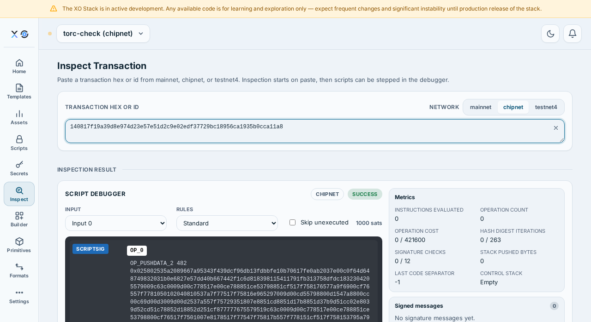
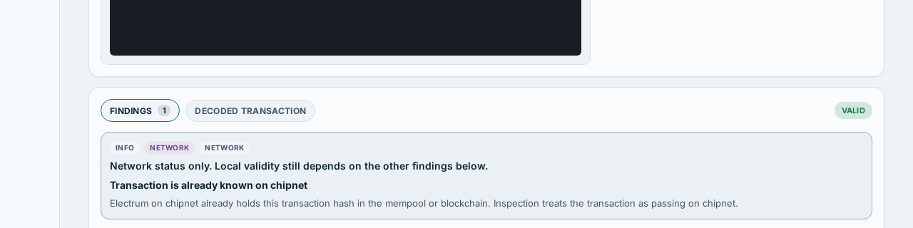

# Torc on XO ("Build with XO")

`xo/torc-contribute.template.json` is an original XO wallet template for Torc. A member's XO wallet pays one
round's contribution into the TorcCircle covenant, and the covenant checks it the same way it checks the web app.

## Result (chipnet)

| | |
|---|---|
| Contribute tx (XO engine, invitation flow) | [`140817f19a39d8e974d23e57e51d2c9e02edf37729bc18956ca1935b0cca11a8`](https://cbch.loping.net/tx/140817f19a39d8e974d23e57e51d2c9e02edf37729bc18956ca1935b0cca11a8) (confirmed, 1,127 bytes) |
| Invitation | `d3922d7fdb7e33113ea8deb34281e0ac`, exported to [`xo/runs/d3922d7fdb7e33113ea8deb34281e0ac.invitation.json`](../xo/runs/d3922d7fdb7e33113ea8deb34281e0ac.invitation.json) |
| Template identifier | `3c611f6c18000ae220669532b1c44003fd570cf0abd540bf4b6d436b097b5795` |
| Circle | "XO Circle", `deployments/chipnet-xo.json`: 3 seats, 0.10 tPUSD, seat 2 ("Yemi") held by the XO wallet |
| Covenant | `bchtest:r02zgd8zwmm3v6lqusqj7phj7dhhzax03h8dtgx45ftgcnqyvky558wnyn6jp` |
| Inspect | <https://blaze.xo.cash/inspect-transaction>: pick **chipnet** and paste the txid. The result is **SUCCESS / VALID**, and all 3 inputs step through the debugger. |




blaze.xo.cash asks for an account before any tab works. Use **Create new account**, network **chipnet**, as a
throwaway. Inspect has no deep link, so you paste the txid. To view the invitation instead, open **Templates → Import**
and load `xo/torc-contribute.template.json`, then import the invitation JSON above (not tried yet).

## What the template does

- **Roles:** `member` holds a seat NFT and the asset, and signs. `circle` is the Torc app: it supplies the covenant's
  live state UTXO, the circle parameters and the next state commitment.
- **`receiveSeat`** (start action) generates `memberKey` and gives a P2PKH seat address. The organiser sends the seat
  NFT and tPUSD there.
- **`contribute`** builds the TorcCircle `contribute()` transaction:
  - in0: the state NFT at the covenant (`<0>` selector; p2sh32 appends the redeem script)
  - in1: the seat NFT
  - in2: the tPUSD payment
  - out0: the new state (this seat's paid bit set)
  - out1: exactly `contribution` tPUSD + 1,000 sats to the covenant
  - out2: the seat NFT back unchanged
  - out3: tPUSD/sats change back to the member

  The covenant redeem script is built inside the template from the circle's variables plus the compiled
  `TorcCircle.cash` body, so the template's covenant address is the same one the app derives.
- `xo/build-template.ts` regenerates the template from `src/contracts/TorcCircle.json` and validates it with
  `@xo-cash/utils` `parseTemplate`.

## How to run it

```bash
npm ci --ignore-scripts && npm rebuild sqlite3 --ignore-scripts=false   # see XO-NOTES: node-gyp/distutils
node xo/patch-chipnet-headers.mjs                                        # chipnet min-difficulty header patch
# Only if your egress blocks Electrum WSS (:50004): bridge Electrum over the app's HTTPS relay
node xo/electrum-relay-shim.mjs &  export XO_ELECTRUM_WS=127.0.0.1:50993
export TORC_XO_DIR=~/.torc-xo            # throwaway mnemonic + state, 0600, outside the repo

node xo/xo-runner.mjs setup              # import template, receiveSeat invitation -> seat address
node xo/xo-runner.mjs track              # store + subscribe the seat address (see XO-NOTES #1)
# fund: create a circle with the seat address as a member, send tPUSD + sats to it
npx tsx xo/make-job.ts deployments/chipnet-xo.json <seat address>   # -> /tmp/xo-job.json (XO_JOB to override)
XO_DRY_RUN=1 node xo/xo-runner.mjs contribute /tmp/xo-job.json      # build + sign, print tx hex, no broadcast
node xo/xo-runner.mjs release            # archive the dry-run invitation (frees its reserved UTXOs)
node xo/xo-runner.mjs contribute /tmp/xo-job.json                   # build + sign + executeAction(broadcast)
node xo/xo-runner.mjs export <invitationId>                         # invitation JSON for blaze.xo.cash
node xo/blaze-inspect-check.mjs <txid>   # headless blaze.xo.cash inspection -> /tmp/blaze-inspect.png
```

The runner's invitation flow:
1. `createInvitation(contribute, member)`, then `joinInvitationRole(circle)`.
2. `appendInvitation` with the variables (BigInt numbers).
3. `appendInvitation` with the inputs by outpoint. The circle role adds the covenant input's unlocking bytecode itself.
4. `appendInvitation` with the outputs, then locktime and version.
5. `signInvitation(id, i)` for each of `listOwnInputIndexes`.
6. `executeAction({ broadcastTransaction: true })`.

## Chipnet records for this run

- tPUSD for the XO run: genesis `f0ca59ef95c6854ad6320c72001bba3aa02adec64ac8dcab084c4a306b0873c5`, distribution
  `22851ec28904ea61068b844b623d8f6874304413c8decdcba09e19b926e43b0c`, category `834987644df6…57a6689`.
- XO Circle genesis `6efc2706ca1e7941f589b5f0b229e0f93938f34dd7c306091d4fec167a654dc7`.
- Contribute (XO) `140817f19a39d8e974d23e57e51d2c9e02edf37729bc18956ca1935b0cca11a8`.

## Upstream issues found (minimal repros)

Each one is a few lines to reproduce against `@xo-cash/engine` 0.1.1-next.18029697917 on chipnet. More detail is in
[XO-NOTES.md](XO-NOTES.md).

1. **`executeAction` broadcasts a transaction whose inputs are still unsigned.**
   - Repro: append an input the wallet cannot sign, skip signing, then call
     `executeAction(id, { broadcastTransaction: true })`. `listMissingRequirements(id).inputsMissingSignatures` is
     non-empty, yet the engine builds the tx with empty unlocking bytecode and broadcasts it. The node rejects it with
     `mandatory-script-verify-flag-failed (Operation not valid with the current stack size)`. This was the original
     Torc failure.
   - Expected: refuse locally with the list of unsigned inputs.
2. **`signInvitation(id)` without an input index** throws
   `Commit not found for merged input undefined …` instead of signing all own inputs or naming the missing argument.
3. **`resolveInvitationOutputLockingBytecode` compiles but does not track.**
   - Repro: `createInvitation(receive)`, then `resolveInvitationOutputLockingBytecode(id, out, role)`, then fund the
     address. `listUnspentOutputs()` stays `[]` forever, and later spends cannot be signed.
   - Workaround: `appendInvitation(id, { outputs: [{ outputIdentifier, roleIdentifier }] })` stores and subscribes the
     script hash, and the same bytecode then tracks.
4. **A failed broadcast leaves its inputs reserved.** Every retry then fails with
   `UnspentOutputReservationExternalConflictError`. The only release is `archiveInvitation`, which is not documented
   as the way to unreserve.
5. **Inputs the wallet does not own cannot be compiled by the engine,** even when their unlocking script needs no keys
   (`<0>` + redeem script). `listOwnInputIndexes` skips them. A dapp or covenant participant has to append raw
   `unlockingBytecode` itself.
6. **Chipnet header validation**: `@electrum-cash/application` rejects chipnet minimum-difficulty header 332451, so
   the engine never syncs. Patched locally with `xo/patch-chipnet-headers.mjs` (testnets only).
7. **Template authoring pitfall:** `lockingType: "p2sh"` compiles to Libauth `p2sh32` and wraps the named script.
   Naming a script that is already `OP_HASH256 <h> OP_EQUAL` wraps it twice, and the broadcast fails at the
   covenant's `OP_EQUALVERIFY`. Fixed in this template; worth one line in the template docs.
